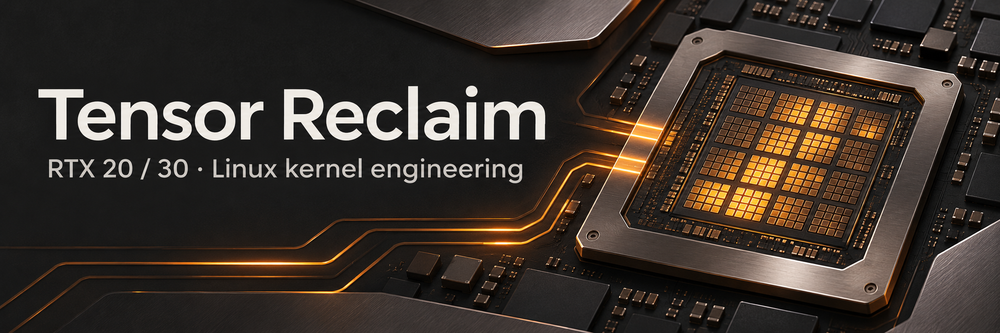

# Tensor Reclaim

[](https://github.com/GWeale/tensor-reclaim/actions/workflows/checks.yml)
[](LICENSE)

[Quick start](#quick-start) · [Engine changes](#engine-changes-and-evidence) ·
[Validation](docs/VALIDATION.md) · [Changelog](CHANGELOG.md) ·
[Contributing](CONTRIBUTING.md) · [Security](SECURITY.md)

An RTX 20/30 engine fork of [Zagitta/gpu-unlock](https://github.com/Zagitta/gpu-unlock)
with corrected Turing bring-up and an Ampere path that writes the speed selectors
from signed firmware while preserving the entry protection masks. It also restores
reported laptop recipes. Read-only preflight, recovery planning, and benchmark
capture support those engine changes.

The goal is reliable access to the hardware's unlocked tensor rate. This fork
claims no rate beyond that unlock and no measured speed advantage over upstream.
The improved-module RTX 3080 trial is **pending**. Turing remains **experimental**.

Previously **GPU Unlock Plus**. Existing `gpu-unlock-plus` commands, the
`gpu_unlock` module, and package names remain compatible.

Fork CLI version **0.1.0**. Kernel/package version remains **2.0.0**; identify a
fork build by its Git revision and module hash. Upstream base:
`7eb51bccae0a0b7e599e084d971170e9a1e82d0c`.
[UPSTREAM.md](UPSTREAM.md) preserves the original README at that base, including
its original claims and credits.

## Quick start

Inspect a Linux host with Python 3.10 or later. These commands use the standard
library and do not install anything, change boot settings, or access GPU registers.

```sh
git clone https://github.com/GWeale/tensor-reclaim.git
cd tensor-reclaim
./gpu-unlock-plus doctor
./gpu-unlock-plus status
```

Start with the exact PCI IDs and observations in the report. Before installing,
read [setup and recovery](#review-setup-and-recovery) and the
[validation limits](docs/VALIDATION.md). For development, run `make check`.

## Engine changes and evidence

- **Turing TU102/TU104/TU106:** tolerate the known stale HALTED state only on
  the Turing loader paths, allow physical DMA without a context, and clear
  DMACTL before loading FWSEC. The two-write chain releases ACR mutex 3, opens
  FEAT, and clears WPR2. The handoff preserves selectors by avoiding FLR and
  requires halted engines, idle DMA, no pending PCIe transactions, and WPR2 down.
  The 10 ms reset delay is empirical. Its actual readiness condition is unknown.
- **Ampere direct selectors:** one signed Booter launch writes SS0 and SS1.
  The host never opens WPR_CFG or FEAT PLMs in this mode. Both selectors and
  unchanged protection-mask readbacks are mandatory before success. There is
  no second launch, FRTS refill, or automatic fallback after a failed launch.
- **Bounded compatibility:** restore GA106M `2520` and `2560`, add reported
  GA103M `2420`, and add reported GA107 `25a2`. Other IDs proposed for GA107
  remain excluded.

`gpu_unlock.direct=-1` is the default: direct mode on GA102, the existing PLM
path on other dies. `gpu_unlock.direct=0` selects the legacy route before any
launch. `gpu_unlock.direct=1` explicitly enables direct mode on the listed GA10x
recipes, including untested GA103/GA104/GA106/GA107 direct paths. Turing and Ada
keep their own recipe regardless of this parameter. Changing modes after a
failed launch requires recovery and a cold start; the engine never retries by
switching modes.

| Engine path or card | External evidence | This fork's evidence | Physical status here |
| --- | --- | --- | --- |
| TU102/TU104/TU106 | [#294](https://github.com/Zagitta/gpu-unlock/pull/294) and [#242](https://github.com/Zagitta/gpu-unlock/issues/242) report multiple RTX 2060/2070/2080 variants, including aarch64 | Production C fake-MMIO reset, loader, transaction, bounds and quiescence checks; reference payload hash | Untested; experimental |
| GA102 direct | [Lukium #252](https://github.com/Zagitta/gpu-unlock/pull/252): eight RTX 3090 cards; reported same throughput as PLM mode | Production C checks enforce one launch, no host selector writes, masks and readbacks | RTX 3080 12 GB stock baseline captured separately; improved-module trial pending |
| Other listed GA10x direct | Shared Booter/recipe is source evidence, not a board test | Synthetic transaction checks | Untested; opt-in only |
| GA106M `2520`, `2560` | [#212](https://github.com/Zagitta/gpu-unlock/pull/212) restores dropped IDs; [#86](https://github.com/Zagitta/gpu-unlock/issues/86) reports `2560` | Both recipes exercised in C; `2520` restored from prior support, not newly validated | Untested |
| GA103M `2420` | [Stradivario #217](https://github.com/Zagitta/gpu-unlock/pull/217): two adapter-mounted laptop cards | Recipe and legacy transaction checks | Untested |
| GA107 `25a2` | [qwecvw #231](https://github.com/Zagitta/gpu-unlock/pull/231): RTX 3050 Mobile | Exact recipe and legacy transaction checks | Untested; no universal GA107 claim |

[Validation and pinned source credits](docs/VALIDATION.md) records exact SHAs,
checks, changes from the proposals, and unexercised hardware behavior.
[The RTX 3080 pilot](docs/RTX3080-PILOT.md) contains build, installation, boot,
evidence, and recovery steps. It is a prepared procedure, not an applied change.

## Check before installing

Basic commands need no sudo, dependency installation, or GPU runtime. Explore
the support table and machine-readable observations with:

```sh
./gpu-unlock-plus support
./gpu-unlock-plus doctor --json
python3 -m gpu_unlock_plus --help
```

`doctor` reads PCI sysfs instead of guessing support from a marketing name.
It checks exact device IDs against `kernel/gpu_unlock/recipes.c`, the current
kernel's headers, tool availability, installed firmware-file presence, bound
drivers, runtime power, Secure Boot, and bootloader candidates. Ada and Turing
recipes are labeled experimental. Ampere's `upstream-established` label describes
upstream maturity, not a new fork hardware certification. Missing or inaccessible
observations remain unknown. File presence does not validate firmware contents.

`status` matches per-card BDFs and the current boot ID in kernel journal records.
Configured targets, a loaded module, and fast benchmarks cannot establish success.
Its `unlocked` state means the engine reported success in this boot; current
hardware selectors always remain `unknown` because this CLI never reads registers.
Later observed failures, suspend/hibernation entry, or runtime-suspended power can
invalidate an earlier success report. Unobserved resets and power loss remain a
limitation. Journal access can be restricted without sudo.

These reports contain local PCI identity. Keep exports private and in ignored
`.local/`, or outside the repository. Raw journal exports are never included in
reports. A supplied `status --journal FILE` export is explicitly unauthenticated.

## Review setup and recovery

Select the exact BDF reported by `doctor`. Repeat `--target` for multiple cards.
The planner refuses `all`, malformed addresses, absent cards, and unsupported IDs.

```sh
./gpu-unlock-plus plan --target 0000:01:00.0
./gpu-unlock-plus plan --target 0000:01:00.0 --loader grub
./gpu-unlock-plus plan --target 0000:01:00.0 --loader systemd-boot
./gpu-unlock-plus plan --target 0000:01:00.0 --loader uki --json
```

Every plan shows the exact kernel argument, a conceptual diff, packaging route,
boot evidence, limitations, and removal instructions. It never executes commands
or edits files. Files on disk identify candidate boot mechanisms only; confirm
the active entry and image generator yourself. There is no universal UKI update
command. Secure Boot may require module signing and an enrolled key; signed UKIs
can ignore external command-line edits. Preserve a known-good boot image.

The retained packaging builds the modified engine:

```sh
# Manual action only after reviewing doctor, the plan, and firmware/NOTICE.md.
# Downloads inputs, installs build dependencies/packages, and rebuilds boot images.
make install
```

Use `make install-deb`, `make install-arch`, or `make install-rpm` when selecting a
specific supported distribution. These commands are inherited upstream behavior;
the Python CLI is run from this checkout and is not installed by the engine packages.
Review [UPSTREAM.md](UPSTREAM.md#local-build) and
[firmware/NOTICE.md](firmware/NOTICE.md) for the pinned input and packaging process.
The generated firmware stays under NVIDIA's terms; this fork supplies no new
custom firmware.

The module needs the plan's explicit `gpu_unlock.targets=BDF[,BDF]` argument in
the confirmed boot source. The existing initramfs hooks run it before NVIDIA
binds. Do not try to unlock an active card by unloading drivers or loading the
module manually after boot. No install, module load, boot edit, or reboot was
performed to validate this fork.

To opt out for one boot, remove every `gpu_unlock.targets=` argument in the
bootloader editor. For a UKI with an embedded signed command line, select a known
good image without that argument. For permanent removal, remove the argument at
its source, regenerate the affected entries/images, and optionally remove the
`gpu-unlock-dkms` and `gpu-unlock-firmware` packages with your distribution's package
manager. The plan prints exact package-removal commands and recovery limits.
If the engine reports retained firmware DMA buffers, power off before retrying;
do not force-remove the module. Resume behavior is inherited; hibernation is not
covered by the engine's resume recovery.

## Capture and compare controlled benchmarks

Capture needs an already installed CUDA-enabled PyTorch environment, physical
GPU UUID support, `torch.mm(..., out_dtype=torch.float32, out=...)`, the precision
flags described in [the benchmark contract](docs/BENCHMARKS.md), and readable
`nvidia-smi` identity/power evidence. Unsupported APIs fail closed. No dependency
is installed automatically. CPU-only hosts can use help, fixtures, and compare.

```sh
# On a GPU host, before and after your separately authorized setup experiment:
./gpu-unlock-plus bench --target 0000:01:00.0 --output .local/before.json
./gpu-unlock-plus bench --target 0000:01:00.0 --output .local/after.json
./gpu-unlock-plus compare .local/before.json .local/after.json

# CPU-only demonstration, visibly marked SYNTHETIC FIXTURE ONLY:
./gpu-unlock-plus compare tests/fixtures/baseline.json tests/fixtures/baseline.json
```

Capture uses synchronized CUDA events, bounded shapes/work/memory estimates,
warmups and repeats, quantized-input CPU FP64 reference samples, and finite-output
checks on every timed result. FP16/BF16 input and FP32 output are recorded with
backend precision controls. This is an observed/requested backend contract, not
proof from disassembling GPU instructions. It does not time an LLM or establish
an unlock. FP32 and TF32 benchmark modes are deliberately absent from this release.

Results contain GPU UUID and PCI identity. Capture accepts new `.json` files only
under ignored `.local/`, writes them atomically with mode 0600, and never overwrites
a baseline. Compare rejects mismatched GPU identity, shape, seed, math, environment,
or observed power/clock/temperature conditions. An overlap in repeat ranges is
inconclusive. A matched timing ratio is still not causal proof or a workload claim.
No real benchmark results or performance claims are shipped in this repository.

## Verify the fork

```sh
make check
# Build only, using already installed headers. Never installs or loads a module.
make -C kernel/gpu_unlock KCFLAGS=-Werror -j2
```

Tests compile and execute the production Falcon, payload, recipe, and selector
transaction C implementations against synthetic MMIO. They also exercise the CLI,
synthetic multi-GPU/journal failures, parser boundaries,
comparison refusals, precision/correctness gates, private output preservation,
and upstream package staging under a temporary `DESTDIR`. The existing
`test-module` and `test-packages` container suites are retained for a separately
provisioned build environment. They can download dependencies and run installers
inside containers; `make check` does neither.

[Validation and known limits](docs/VALIDATION.md) records the observed checks.
The [Checks workflow](https://github.com/GWeale/tensor-reclaim/actions/workflows/checks.yml)
runs CPU-only tests on pushes to `main` and pull requests, with Python 3.10 and
3.13 and a C sanitizer pass. It does not install the module or test a physical GPU.
The inherited distribution matrix remains manual-only. The Unraid publisher is
restricted to the original upstream repository. No packaged fork release is
published automatically.

## Contribute and get help

Read [CONTRIBUTING.md](CONTRIBUTING.md) for local checks, source attribution,
hardware evidence requirements, and issue reporting. Track fork problems in
[Issues](https://github.com/GWeale/tensor-reclaim/issues), review changes in
[the changelog](CHANGELOG.md), and report vulnerabilities through
[the security policy](SECURITY.md). Public reports should contain only the
relevant, redacted evidence.

## License and credit

The engine, packaging, and added CLI/tests are GPL-2.0-only. See
[licenses/GPL-2.0.txt](licenses/GPL-2.0.txt),
[licenses/CMP40HX-MIT.txt](licenses/CMP40HX-MIT.txt),
[licenses/NVIDIA-MIT.txt](licenses/NVIDIA-MIT.txt), and
[firmware/NOTICE.md](firmware/NOTICE.md). Zagitta and the upstream contributors
created the unlock engine. The [banner artwork](assets/ARTWORK.md) is a
conceptual illustration generated for this project. Petri Krohn's GA102 chain
remains credited in source.
The Turing integration credits RakkiPoni and nlzy; direct selectors credit Lukium.
GWeale's fork narrows their proposals, enforces readback and transaction gates,
adds host C regression checks, restores reported recipes, and retains the workflow
tooling. [Exact source revisions](docs/VALIDATION.md#source-credits) identify each
contribution.

Successful upstream hardware reports belong in
[the success discussion](https://github.com/Zagitta/gpu-unlock/discussions/238).
Search existing issues before reporting an actual failure. This fork sends no
reports automatically.
